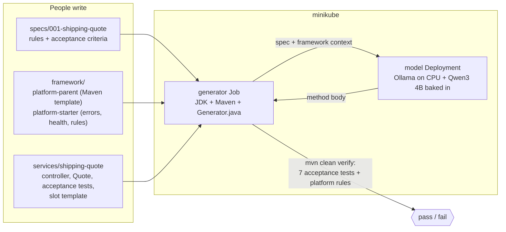

# Spec, framework and a local model, end to end

A reference repository from the [Well Rounded Engineer](https://enrichmeai.com/well-rounded-engineer/) guide:
download it, run it, and see every part. A company framework, a spec written against it, and a small
open-weight model running on your own CPU, packaged to run in Kubernetes on minikube, filling one slot of a service. The
service's own build, its acceptance tests and the framework's architecture rules decide whether the model's
code is kept.

It is a teaching example, not a product. The models it uses are off-the-shelf; it trains nothing.

> **Status: the run commands below are untested end to end.** What has run (see [docs/results.md](docs/results.md)):
> the framework and the service's tests, the CPU runtime image, the model served from a mounted file, the generator against
> it, the generator in the JDK image its Dockerfile starts from, and the manifests rendered. What has **not**:
> building `wre/model:4b` (it ran out of disk here) and `wre/generator`, so `make images`, `make local-model` and
> the minikube path have never completed; and minikube itself, because the environment this was built in cannot
> run containers inside containers. If you run them, please open an issue with what you saw.

## What is in it



| Folder | What it is | Who writes it |
|---|---|---|
| `framework/platform-parent` | The Maven template every service inherits: Java and Spring Boot versions, build plugins | Platform team, once |
| `framework/platform-starter` | One error format (`Errors.notFound`, `Errors.unprocessable`), health checks, and ArchUnit rules every service is tested against | Platform team, once |
| `specs/001-shipping-quote` | What to build: rules and seven numbered acceptance criteria | Product and tech lead |
| `services/shipping-quote` | The controller, the reply type, the acceptance tests (one per criterion), and the slot template | People |
| `generator/` | The harness: spec + framework context to the model, the reply into the slot, the build decides; feeds failing tests back, at most 3 attempts | Platform team |
| `model-runtime/` | A CPU-only Ollama image (about 168 MB of layers) and an image with the model baked in | Platform team |
| `k8s/` | The model Deployment and Service, the generator Job; a GPU overlay | Platform team |
| `docs/` | [Results](docs/results.md), [prompt, framework or spec](docs/prompt-framework-spec.md), [GPU and production](docs/gpu-and-production.md), [upgrades](docs/upgrades.md) | |

**The model writes one method body. Everything else is the framework's or a person's.** That is the
point of the example: see [what we measured](docs/results.md) for why.

## Run it on minikube

Needs Docker, minikube, kubectl, curl, zstd and python3; about 8 GB of memory for minikube and, as an estimate,
15 GB of free disk (the model image build used about 10 GB of builder space here before running out).

```bash
make fetch          # Ollama v0.40.18 (CPU parts only) and the Qwen3 4B GGUF, each checked by SHA-256
make images         # wre/ollama-cpu, wre/model:4b, wre/generator
make minikube-up    # minikube with 4 CPUs and 8 GB, images loaded, the model deployed and ready
make generate       # one generation Job; it succeeds only if the generated service passes its tests
make down           # delete the cluster
```

On Apple Silicon the scripts fetch the arm64 build of Ollama (not tried yet); the model file is the same on
every machine.

## Run it without Kubernetes

Needs Docker, Java 21, Maven, curl, zstd and python3. This is the route every result in
[docs/results.md](docs/results.md) came from. The generator compiles and runs model-written code on your
machine, outside any sandbox; in the Kubernetes route it runs in a pod.

```bash
make fetch                # as above
make local-model-mounted  # the CPU runtime with the model file mounted, on 127.0.0.1:11434 (make stop-model to stop)
make generate-local       # the generator on your machine
# or, after make images: make local-model  (the model baked into wre/model:4b; not built here yet)
make repeat         # the same spec five times at temperature 0, and five at 0.7
make reference-check  # the hand-written slot against the tests: proves the tests can pass
```

## What it showed

From [docs/results.md](docs/results.md), all on 4 CPU cores:
- A 1.7B model failed until the framework, the slot, the spec and the harness were fixed, then passed only
  1 of 10 single attempts and could not repair its own mistakes. A 4B model **passed on the first attempt**
  (25 to 52 s with the current spec), and passed every one of its 12 runs.
- Each failure was fixed outside the prompt: a friendlier framework API, a smaller slot, a clearer spec,
  a cleaner build, and a framework bug that generated code exposed.
- **The same spec, repeated**, with the 4B model and the current spec: seven runs at temperature 0 with a fixed
  seed gave the same file; five runs at 0.7 gave five different files (one of them the same as the temperature-0 file), all of which passed. With an earlier
  spec, the first run after the model loaded differed from the warm ones. The tests decide, not the diff.

## Licence

Apache 2.0 ([LICENSE](LICENSE)). The model and Ollama are downloaded, not included; their licences are in
[NOTICE](NOTICE).
